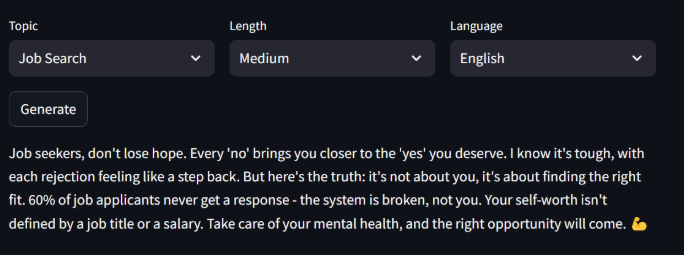
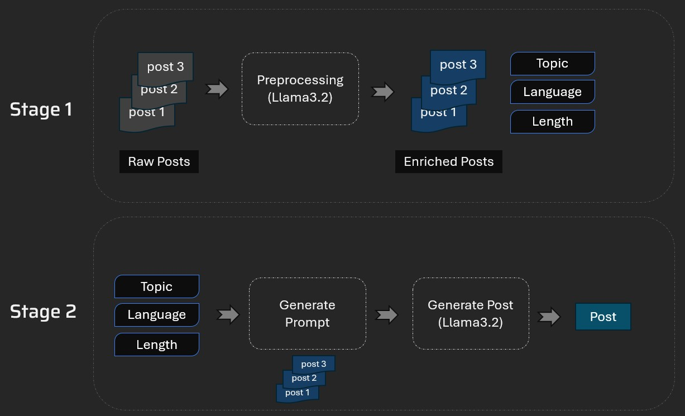

# LinkedIn Post Studio
This tool analyzes a LinkedIn creator's past posts and helps generate new posts that match their writing style and voice.



A LinkedIn creator can feed their past posts into this tool to extract key topics and writing patterns. They can then choose the topic, length, and language before generating a new post that fits their voice.

## Technical Architecture


1. Stage 1: Collect LinkedIn posts and extract Topic, Language, Length, and related metadata.
1. Stage 2: Use the selected topic, language, and length to generate a new post. Relevant past posts are used for few-shot learning so the language model can mirror the creator's writing style.

## Set-up
1. To get started, create an API key here: https://console.groq.com/keys. Inside `.env`, update the value of `GROQ_API_KEY` with the key you created.
2. Install the dependencies using:
    ```commandline
     pip install -r requirements.txt
    ```
3. Run the Streamlit app:
   ```commandline
   streamlit run main.py
   ```
